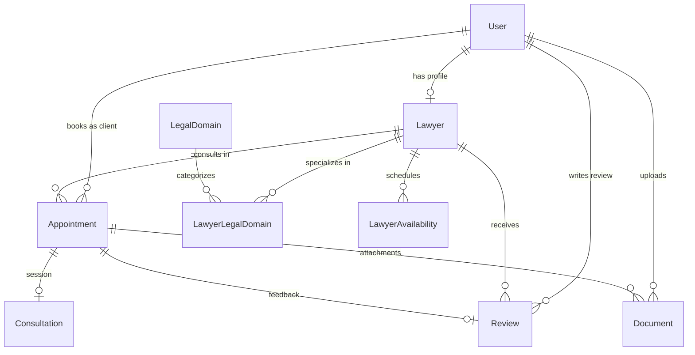

# Technical Documentation
## Online Legal Consultation & Lawyer Aggregation Platform

**Version:** 1.0.0  
**Stack:** React 19 (Vite), TypeScript, Tailwind CSS, Node.js, Express 5, Prisma ORM, PostgreSQL  

---

## 1. System Architecture

The platform is designed as a decoupled client-server multi-tier web application optimized for concurrent legal consultations, scheduling integrity, and multi-tenant role isolation.

```
[ Web Client / Browser ]
        │  (HTTPS / REST / JSON)
        ▼
[ Reverse Proxy / Vite Server :3000 ]
        │  (Proxy /api/v1 & /uploads)
        ▼
[ Node.js + Express 5 API Server :5000 ]
   ├── Authentication Middleware (JWT & BCrypt)
   ├── Role Authorization Guard (CLIENT, LAWYER, ADMIN)
   ├── Rate Limiting & Helmet Security
   └── Static Storage Handler (Uploads)
        │  (Prisma ORM Client & Pg Adapter)
        ▼
[ PostgreSQL Database (legal_consultation) :5432 ]
```

---

## 2. Security Architecture

1. **Authentication:** 
   - Uses stateless JSON Web Tokens (JWT) signed with HMAC-SHA256.
   - Tokens carry payload `{ userId, role }` with a 7-day expiration window.
2. **Password Security:**
   - Passwords hashed using `bcrypt` with work factor 10.
3. **Role-Based Access Control (RBAC):**
   - Express middleware enforcing strict role gates:
     - `/api/v1/admin/*` restricted strictly to `role === "ADMIN"`.
     - `/api/v1/lawyers/me/*` and `/api/v1/lawyers/availability` restricted to `role === "LAWYER"`.
     - Cross-user appointment privacy checks ensuring clients and lawyers can only access appointments where they are designated parties.
4. **File Storage & Upload Security:**
   - Handled via `multer` storage engine with localized storage key randomization (`${Date.now()}-${random}.${ext}`).
   - MIME whitelisting: PDF, PNG, JPG, WEBP, DOCX, TXT.
   - Size limitation: 10MB per document payload.
5. **Database Protection:**
   - Prisma ORM uses parameterized queries preventing SQL injection vulnerabilities.

---

## 3. Database Schema & Data Models

### 3.1 Entity Relationship Diagram



### 3.2 Schema Data Dictionary

#### `User` Table
| Column | Type | Constraints | Description |
|---|---|---|---|
| `id` | UUID | Primary Key | Unique user identifier |
| `fullName` | String | NOT NULL | User's full display name |
| `email` | String | UNIQUE, NOT NULL | Account email for authentication |
| `phone` | String | Nullable | Contact mobile number |
| `password` | String | NOT NULL | Bcrypt password hash |
| `role` | Enum (`CLIENT`, `LAWYER`, `ADMIN`) | Default `CLIENT` | Access level |
| `isActive` | Boolean | Default `true` | Account active / suspension status |
| `createdAt` | Timestamp | Default `now()` | Registration timestamp |

#### `Lawyer` Table
| Column | Type | Constraints | Description |
|---|---|---|---|
| `id` | UUID | Primary Key | Unique lawyer identifier |
| `userId` | UUID | UNIQUE, Foreign Key -> `User.id` | Associated user identity |
| `barRegistrationNumber` | String | UNIQUE, NOT NULL | Official Bar Council registration ID |
| `barCouncil` | String | NOT NULL | State Bar Council name |
| `yearsOfExperience` | Integer | NOT NULL | Verified legal experience |
| `location` | String | NOT NULL | City / Jurisdiction |
| `consultationFee` | Decimal(10,2) | NOT NULL | Fee per 30 min consultation |
| `bio` | Text | Nullable | Advocate summary & courtroom background |
| `verificationStatus` | Enum (`PENDING`, `APPROVED`, etc.) | Default `PENDING` | Platform accreditation status |

#### `Appointment` Table
| Column | Type | Constraints | Description |
|---|---|---|---|
| `id` | UUID | Primary Key | Consultation booking ID |
| `clientId` | UUID | Foreign Key -> `User.id` | Booking client |
| `lawyerId` | UUID | Foreign Key -> `Lawyer.id` | Selected advocate |
| `scheduledAt` | Timestamp | NOT NULL | Scheduled appointment time |
| `duration` | Integer | Default `30` | Duration in minutes |
| `mode` | Enum (`AUDIO`, `VIDEO`, `CHAT`) | Default `VIDEO` | Consultation channel |
| `status` | Enum (`PENDING`, `ACCEPTED`, `REJECTED`, `CANCELLED`, `COMPLETED`) | Default `PENDING` | Booking lifecycle status |
| `notes` | Text | Nullable | Client matter description |

#### `Consultation` Table
| Column | Type | Constraints | Description |
|---|---|---|---|
| `id` | UUID | Primary Key | Consultation session ID |
| `appointmentId` | UUID | UNIQUE, Foreign Key -> `Appointment.id` | Associated booking |
| `startedAt` | Timestamp | Nullable | Live session commencement time |
| `endedAt` | Timestamp | Nullable | Live session termination time |
| `duration` | Integer | Nullable | Actual elapsed time in minutes |
| `summary` | Text | Nullable | Advocate's legal opinion & advice summary |
| `status` | Enum (`SCHEDULED`, `IN_PROGRESS`, `COMPLETED`, `CANCELLED`) | Default `SCHEDULED` | Live room state |

---

## 4. Scheduling & Conflict Resolution Algorithm

When a client initiates an appointment booking via `POST /api/v1/appointments`, the backend performs atomic three-tier validation:

1. **Lawyer Accreditation Check:**
   - Verifies the lawyer has `verificationStatus === 'APPROVED'` and `user.isActive === true`.
2. **Weekly Availability Match:**
   - Calculates the target day of week (`0` = Sun, `6` = Sat) and target time `HH:MM`.
   - Queries `LawyerAvailability` to ensure an active recurring slot encloses the requested booking time (`startTime <= targetTime <= endTime`).
3. **Conflict Detection (Overlapping Bookings):**
   - Calculates target interval: `[scheduledAt, scheduledAt + duration]`.
   - Queries existing appointments with status in `['PENDING', 'ACCEPTED']` where:
     $$\text{scheduledAt} < \text{targetEnd} \quad \text{AND} \quad \text{scheduledAt} \ge \text{targetStart} - \text{duration}$$
   - If an overlapping appointment exists, the server rejects the request with HTTP `409 Conflict`.

---

## 5. REST API Endpoints Specification

### Authentication
* `POST /api/v1/auth/register` — Registers new client or lawyer user.
* `POST /api/v1/auth/login` — Returns JWT bearer token and user object.
* `GET /api/v1/auth/me` — Validates current JWT and returns user claims.

### Lawyers & Availability
* `GET /api/v1/lawyers` — Public directory search with query parameters (`search`, `legalDomain`, `location`, `minExperience`, `maxFee`).
* `GET /api/v1/lawyers/:id` — Public lawyer profile with domains, reviews, and availability timetable.
* `POST /api/v1/lawyers/apply` — Submits advocate accreditation request.
* `GET /api/v1/lawyers/me/profile` — Authenticated lawyer's own profile and documents.
* `PATCH /api/v1/lawyers/me/profile` — Update fees, bio, and practice areas.
* `GET /api/v1/lawyers/me/earnings` — Returns gross earnings, pending earnings, 6-month trends, and ledger.
* `GET /api/v1/lawyers/availability` — Returns lawyer's recurring availability slots.
* `POST /api/v1/lawyers/availability` — Add new availability slot.
* `DELETE /api/v1/lawyers/availability/:id` — Remove an availability slot.

### Appointments & Consultations
* `POST /api/v1/appointments` — Book consultation slot.
* `GET /api/v1/appointments` — User's consultation history (filtered for Client, Lawyer, or Admin).
* `GET /api/v1/appointments/:id` — Specific appointment details.
* `PATCH /api/v1/appointments/:id/status` — State transition: Lawyer can `ACCEPT` / `REJECT`; Client/Lawyer can `CANCEL`.
* `GET /api/v1/consultations/:appointmentId` — Consultation room metadata, participants, and chat history.
* `POST /api/v1/consultations/:appointmentId/start` — Start virtual consultation.
* `POST /api/v1/consultations/:appointmentId/end` — Conclude consultation and calculate duration.
* `POST /api/v1/consultations/:appointmentId/summary` — Save case notes and legal opinion.
* `POST /api/v1/consultations/:appointmentId/chat` — Send in-room encrypted message.
* `GET /api/v1/consultations/:appointmentId/chat` — Retrieve in-room message log.

### Documents & Reviews
* `POST /api/v1/documents/upload` — Multipart file upload (`CONSULTATION` or `LAWYER_VERIFICATION`).
* `GET /api/v1/documents/appointment/:appointmentId` — Fetch case documents.
* `GET /api/v1/documents/download/:id` — Serve file with correct MIME type.
* `POST /api/v1/reviews` — Submit 1–5 star rating and comment for completed appointment.
* `GET /api/v1/reviews/lawyer/:lawyerId` — Public published reviews for lawyer.

### Admin Governance & Analytics
* `GET /api/v1/admin/analytics` — Executive KPI metrics (users, verified lawyers, booking rate, avg duration, ratings, platform volume).
* `GET /api/v1/admin/lawyers` — Filter and review lawyer applications with submitted Bar certificates.
* `PATCH /api/v1/admin/lawyers/:id/verification` — Update verification status (`APPROVED`, `UNDER_REVIEW`, `REJECTED`, `SUSPENDED`).
* `GET /api/v1/admin/users` — Search and manage platform users.
* `PATCH /api/v1/admin/users/:id/status` — Toggle user active / banned state.
* `GET /api/v1/admin/consultations` — Platform-wide appointment oversight log.
* `GET /api/v1/legal-domains` — List legal categories.
* `POST /api/v1/legal-domains` — Create new legal domain.
* `PATCH /api/v1/legal-domains/:id` — Update legal domain.

---

## 6. Deployment & Execution Instructions

### Local Development Setup

1. **Database Setup:**
   Ensure PostgreSQL is running locally on port 5432 with database `legal_consultation`.

2. **Backend Startup:**
   ```bash
   cd backend
   npm install
   npm run build
   npx tsx prisma/seed.ts     # Populates admin, verified lawyers, availability, domains
   npm run dev                # Starts API server on http://localhost:5000
   ```

3. **Frontend Startup:**
   ```bash
   cd frontend
   npm install
   npm run dev                # Starts Vite development server on http://localhost:3000
   ```

4. **Production Build:**
   ```bash
   # Build Backend
   cd backend && npm run build
   # Build Frontend
   cd frontend && npm run build
   ```
